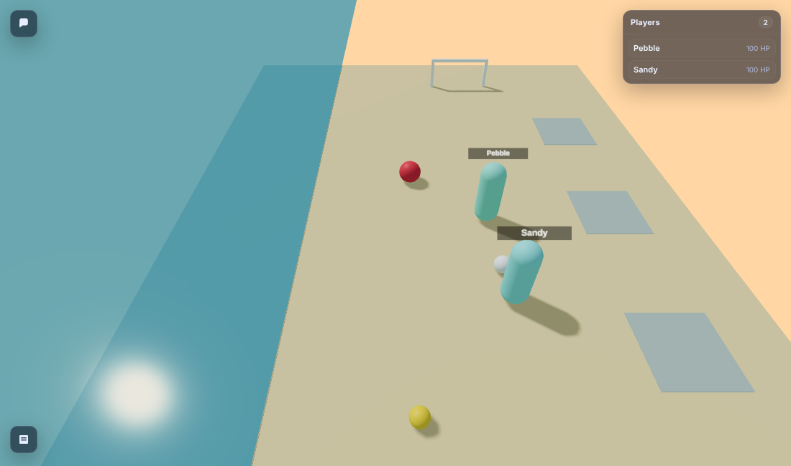

# Beach world report: our own Clawblox world, and the adapter taught to play it

Date: 2026-10-14 · Clawblox commit `8be90a0` (same as jobs 01 and 02, built outside this repo) ·
tokenizer: **Gemma 4 E4B** (`google/gemma-4-E4B-it`, as in job 02).



## Coverage statement

**Built**
- `worlds/beach/`: `main.lua` (the world), `world.toml`, `API.md`, and `renderer/`
  (adapted from mesa-island's renderer). Clawblox attribution is in `renderer/LICENSE.clawblox`
  and `NOTICE.md`.
- Adapter changes in `adapters/clawblox/`:
  - per-world `Rules` (`MESA_RULES`, `BEACH_RULES`), detected automatically;
  - the Kick and Mold actions;
  - castles described as one line each;
  - players named from a label the world puts on each character;
  - world announcements delivered as `World:` chat lines;
  - a beach map card;
  - `beach/PLAY_CARD.md` (400 tokens).
- A chat-cursor bug fix, explained below.
- Name hygiene: job 01/02's test players "Alice" and "Bob" were renamed to the neutral names
  "Coral" and "Drift" everywhere (fixtures, tests, scripts, reports). No measurement changed.
- `scripts/beach_agent.py` (a scripted player that sees only the adapter's text),
  `scripts/beach_two_players.py`, and `scripts/beach_capture_fixtures.py`.

**Tested**
- 66 unit tests pass: 28 new beach tests on 6 recorded beach fixtures, plus the job-02 tests,
  which still pass.
- The live tests (mesa-island plus a new live beach round) pass 5 out of 5 runs.
- The scripted beach player completed **every task in 3 out of 3 runs**.
- The two-player script passed every check.
- A regression run of job 02's mesa-island agent still completes its task.

**Measured**
- Ball physics: kick distances, the beach ball against an identical ball without the
  approximation, and sea wash-back timing.
- Bundle sizes per turn, the worst case, castle line against piece listing (one castle and a
  4-castle "castle city"), and text against JSON.

**Didn't get to, or couldn't do**
- **No language model was run**; scripted players prove the information is sufficient, not that
  a 4B model plays well.
- The **announcement banner** in the browser view is written but I didn't see it on screen.
- Proximity chat (`speech.mode = "proximity"`) wasn't tried; the beach uses global chat.
- Clawblox's terrain water (which has real buoyancy and drag) wasn't tried for the sea; see
  "The sea".
- On **mesa-island**, players you've never had in front of you are still "unknown player". The
  engine offers no way to name them (see "Naming everyone").
- I didn't review `src/game/physics/*.rs` beyond what's cited here.

## Physics, from `docs/physics.md` and the engine source

`docs/physics.md` lists `CustomPhysicalProperties`, forces (BodyForce, VectorForce, AlignPosition,
...) and terrain water, but says little about how friction, elasticity or damping work.
From the source and a scratch "physics lab" world:

- **Friction and elasticity are averaged.** Each part's values go straight to Rapier colliders
  (`src/game/physics/parts.rs`), and no combine rule is set, so Rapier's default (average)
  applies. `FrictionWeight` and `ElasticityWeight` are stored but never reach the physics.
- **There is no damping or rolling resistance.** In the lab, a soccer ball given 20 studs/s
  dropped to 14.23 within 0.5 s (sliding turns into rolling), then rolled at **exactly 14.23
  for 10 more seconds**. That happened on sand with friction 1.5 and on ice with friction 0.05
  alike. Friction only affects that first slide. Without help, a ball kicked on flat sand
  never stops.
- **The only built-in drag is terrain water** (`src/game/instance/fluid_physics.rs`:
  buoyancy, linear drag 8, quadratic 0.9), and only inside water voxels.
- **Stacking and toppling are real physics.** Three aligned blocks stand; a wall cantilevered
  0.8 past its support tips over by itself.
- **A Lua error halts the whole world instance** ("Instance stopped due to Lua error") until
  restart. The beach script avoids risky calls, but this is a fragility of every world.

So "sand that stops balls" and "a beach ball that floats" can't come from physical
properties alone. Both are **scripted approximations** in `main.lua`, described below.

## Design choices

| Choice | Value | Why |
|---|---|---|
| Size | sand 28 × 60 (x −14..14, z −30..30), plus 10 of shallow water | Walking speed is 16/s: the length takes ~4 s, the width ~2 s. Mesa-island is 160 across. The observation radius (80) covers the whole beach, so everyone is always in range. |
| Layout | sea along the long east side; goals at the north and south ends; 4 castle plots along the west side; 6 spawn points down the middle | Soccer runs north–south through the middle. Castles sit at the side, close enough that a wild kick can knock one down. |
| Ground | flat, friction 1.2, elasticity 0 | No slope, so nothing rolls by itself. Low bounce. |
| Gravity | 35 | Mesa-island uses 10, which makes everything floaty and would hide the beach ball's difference. At this scale Earth would be about 28. Jumps rise 2.2 (measured). |
| Rolling resistance | velocity × e^(−k·dt) while a ball touches the sand; k = 1.2 soccer, 1.6 volleyball, 2.5 beach ball | The engine has none (above). With it, a ball only goes far when kicked hard. |
| Kick | nearest ball within **3** (horizontal); speed = power × min(20 / mass, 40), plus a small lift | Linear power: a light kick is light for every ball. Reach 3 = body radius 1 + ball radius 0.6 + the slack MoveTo leaves (it stops ~2.6 from a ball). 2.5 failed in practice. |
| Max players / AFK | 8 / 300 s | Job 01: one stray join with no leave locked everyone out. |
| Scenery | every scenery part tagged `Static` | Never in observations. The raw beach observation is 4.5–10.6 KB, against mesa-island's 23 KB. |

**The balls** (each can be picked up, thrown and kicked):

| Ball | Diameter | Density / mass | Friction / elasticity | Kicked at power 1 | At power 0.3 |
|---|---|---|---|---|---|
| soccer ball | 1.2 | 0.8 / 0.72 | 0.6 / 0.5 | 24.6, stops after ~7 s | 5.1 |
| volleyball | 1.1 | 0.3 / 0.21 | 0.5 / 0.85 | 24.9 (hits the 40 cap) | 5.9 |
| beach ball | 1.8 | 0.05 / ~0.15 | 0.5 / 0.7 | 21.1, floats (peak 1.7) | 6.3 |

### The beach ball: does it feel different?

**Yes, but by approximation, not by air physics.** On the beach ball only, every tick the
script applies:
- an upward push cancelling 80% of gravity;
- quadratic drag in flight (0.06·|v|·v);
- a light northward breeze while it's airborne.

A/B test: the beach ball and an otherwise identical "plain" ball were launched together, with
the same velocity (7.2 up, 20 forward), in a scratch copy:

| t (s) | beach ball height / forward | plain ball height / forward |
|---|---|---|
| 0.3 | 2.49 / 5.4 | 1.45 / 6.3 |
| 0.6 | **3.03** / 9.3 | 0.89 (landed) / 11.0 |
| 0.9 | 2.90 / 12.5 | rolling / 13.6 |
| 1.5 | 1.07 / 17.5 | rolling / 15.4 |
| 3.0 | rest / 20.4 | rest / 15.9 |

The beach ball goes twice as high, stays up three times longer, and drifts on after the plain
ball has stopped. That's a visible, different behaviour. It is not simulated air resistance,
and `API.md` says so.

### The sea

The sea floor is level with the sand. The water is a transparent, non-colliding `Ocean` part.
East of the shoreline (x > 14) the script slows a ball (drag 2.5/s); after 3 s in the water it
drifts back towards the shore at 4/s. Measured: a ball kicked into the sea entered the water at
1.0 s and was back on the sand at 5.6 s. Sand pieces that end up in the sea dissolve.

I chose this over Clawblox's terrain water (real buoyancy and drag) because terrain water needs
voxel terrain and renderer support I didn't test. It's a reasonable next step.

### Goals

Each end has two poles 6 apart and a crossbar 3 high, all static and solid; the goal zone
itself is invisible. A goal counts **when a ball crosses the goal line between the posts**. The
first version counted any ball behind the line, and a beach ball that rolled along the back
wall into the zone "scored" from outside the posts; tracking the crossing fixed it. On a goal
the world:
- adds to `Score.North` or `Score.South`;
- announces "Goal at the north end! (soccer ball)";
- returns the ball to the centre 3 s later.

**Announcements.** The engine has no way for a world script to post into the HTTP chat
(nothing chat-related exists in `src/game`). The world fires an `Announce` replicated event
instead. Every observation carries it in `recent_events`, the adapter turns it into a
`World: ...` chat line, and the renderer shows it as a banner.

### Sandcastles

- **Pieces.** A new action, **Mold**, makes a piece in your empty hands: block 1×1×1, tower
  1×2×1, wall 2×1×0.5, flag 0.25×1.5×0.25. Pieces have density 1.6, friction 1.0 and no
  bounce, and at most 40 can exist at once. I added Mold because the brief didn't say where
  pieces come from. Molding from sand keeps the beach free of supply piles, which would cost
  tokens in every observation.
- **Placing.** Place puts pieces down **upright by default** and checks overlap with a probe 90%
  of the piece's size. Resting exactly on the piece below then counts as free, while real
  overlaps still fail. Stacking rule: y = the top of the piece below + half the new piece's
  height.
- **Toppling.** Nothing scripts a collapse; physics does it. The script only notices: a piece
  that was resting at least 0.5 higher, or was just put down higher, and then comes to rest
  lower has fallen. The plot's `Falls` count goes up, and the world announces "The sandcastle
  in plot N fell down!".
- **Plots** come from one `PLOTS` table at the top of `main.lua`: `enabled`, `half_size` and
  a list of `{id, x, z}`. A keeper can move, add or remove plots, or switch them all off.
  Each plot publishes `Pieces`, `Height` (solid pieces only; a flag doesn't add height),
  `HasFlag`, `Settled` and `Falls`.

### Naming everyone

The engine lists other players by name only inside your 105° view cone (job 01). The beach
world fixes that at the source: it labels each character with a `PlayerName` attribute, and
the adapter names every character in range, in view or not. In the two-player run, Pebble saw
"Sandy ... (not in view)".

For **mesa-island** (whose script we don't change) the engine offers no way to do this:
- `other_players` is filtered by view cone;
- chat senders carry an agent id that doesn't map to a world entity;
- the spectator endpoint, which does have names and positions, needs the operator's spectator
  token.

So mesa-island keeps "unknown player" until someone has been in front of you.

## The adapter on the beach

- **Rules.** `BEACH_RULES` holds every beach number: reach 6/7, match 1.5, kick reach 3, throw
  cap 10, jump rise 2.2, place clearance 0.05, shapes, 40-piece cap, and the action list. The
  adapter detects the world from the `BeachMap` folder. Nothing else hard-codes beach values.
- **Kick results** follow the ball: `Kicked the soccer ball N (power 1); it stopped 24.6 away
  at (0,0.6,24.6)`, or `...; Goal at the north end! (soccer ball) The ball goes back to the
  centre.`, or `... in the sea (it will drift back)`. A miss says
  `Kick failed: no ball within 3 of you; nearest is the soccer ball 2.6 N at (0,0.6,0) - walk
  up to it first`.
- **Castles** are one line each:
  `sandcastle in plot 1 (-9.5,0,-18) 4.3 W: 4 pieces, 3 high, with a flag, standing`
  (with `has fallen N times` when relevant). Pieces are listed individually only within your
  pickup reach (6). Loose pieces outside plots are listed as ordinary objects.
- **Look** also tags balls `in the sea` and adds a `score: north 1, south 0` line.
- **Fixed in passing (affects mesa-island too):** `turn_bundle()` used to call `hear()`
  internally, so it consumed the new chat lines before the model's own `hear()` could return
  them. Job 02's solo runs had no one else talking, so they never showed it; the two-player run
  here would have. Chat now has one running log:
  `turn_bundle()` reads it, and only `hear()` moves the "new since last time" cursor.

## Budget table (Gemma 4 E4B tokens)

Three solo runs of the scripted beach player (62 turns each: soccer → sea → good castle → bad
castle → gather balls → chat). One turn is one `turn_bundle()` plus one tool call. The three
runs produced essentially identical numbers (the world is deterministic from a fresh start).

| | tools | state min / median / max | recent min / median / max | **turn total min / median / max** |
|---|---|---|---|---|
| solo runs S1, S2, S3 | 555 | 95 / 186.5 / 384 | 11 / 301.5 / 366 | **675 / ~1,043 / 1,187** |
| two-player run (both players' turns) | 555 | | | **681 / 742.5 / 956** |

**Worst cases:**

| Case | tools | state | recent | **total** |
|---|---|---|---|---|
| Next to a finished castle (3 high, flag) with all three balls within 5, map card included (the requested worst case) | 555 | 581 | 341 | **1,477** |
| Two players, map card included (Sandy / Pebble) | 555 | 393 / 399 | 168 / 201 | **1,116 / 1,155** |
| "Castle city": 4 castles × 9 pieces, standing mid-beach | 555 | 536 | 285 | **1,376** |
| Castle city, standing next to castle 2 | 555 | 504 | 272 | **1,331** |

Every turn is far under 8k, and typical turns (~1.0k) are under the 2.5–3k target. The raw
beach observation on the same turns was 2.3k–5.5k tokens (median 4.4k). That's already much
smaller than mesa-island's, because the scenery is Static, but it's still about 25× the compact
view.

**Castle description against listing its pieces** (same snapshot):

| | as castle lines | pieces listed one by one |
|---|---|---|
| one castle (4 pieces) | **33 tokens** | 107 tokens |
| castle city (36 pieces in 4 castles) | **143 tokens** | 884 tokens |

**Text against compact JSON** for the beach view: text median 176.5 tokens against JSON 191,
max 306 against 307. Text stays the default, as in job 02.

## Scripted results

**Solo player** (`scripts/beach_agent.py`; it reads only the map card, look, act results and
hear). Each step held in all 3 runs:

| Step | Result |
|---|---|
| Kick a ball into a goal and see it announced | ✓ Two kicks from the centre; the second result read `Goal at the north end! (soccer ball)`; `score: north 1, south 0` |
| Ball into the sea, then retrieve it | ✓ The volleyball showed `in the sea`; the player waded in, picked it up, carried it back and placed it on the sand |
| Build a 3-high castle in a plot that stands | ✓ Three blocks and a flag in plot 1: `4 pieces, 3 high, with a flag, standing`, still standing at the end of the run |
| Build one badly and show it falls | ✓ A wall placed 0.9 off-centre on a tower in plot 4 toppled; `has fallen 1 time`, and `World: The sandcastle in plot 4 fell down!` reached `hear()` |

**Two players** (`scripts/beach_two_players.py`, each with its own adapter):

| Check | Result |
|---|---|
| Both see and name each other | ✓ Sandy saw `Pebble` (in view); Pebble saw `Sandy (not in view)`: named even from behind |
| Chat both ways | ✓ Each `hear()` returned the other's line |
| Pass a ball the other can kick | ✓ Sandy's pass at power 0.4 stopped 7.3 away near Pebble; Pebble kicked it on and scored (`Goal at the north end!`, heard by both) |

**Regression:** job 02's mesa-island agent, rerun on the changed adapter, completed its task
(median 1,138 tokens per turn, max 1,316).

## Limits and risks

- **Approximations, not physics:** sand rolling resistance, the beach ball's floatiness, and
  water drag and wash-back are per-tick velocity edits in Lua. They behave well in tests but
  aren't the engine's own simulation.
- **One Lua error stops the world** for everyone until restart. The beach script is careful,
  but a keeper editing it should test a change before letting people in.
- **Molded pieces are capped at 40.** A busy beach will hit it; then pieces must be reused.
- **The browser view still loads Three.js and lucide from esm.sh** (job 01). Under the
  "Trusted" network setting the page was blank. I verified the renderer by serving the same
  versions from npm in a test-only harness.
- **No `player.glb`:** Clawblox's 4 MB character model is a binary asset beyond the
  renderer-only exception, so players render as name-tagged capsules.
- **MoveTo is still straight-line,** and walking into a ball pushes it (a light volleyball
  especially). The scripted player lines up behind a ball by walking around it first.
- **The engine's own chat** can't carry world messages; announcements go through replicated
  events and so reach adapter users and the browser banner, but not raw `/chat/messages`
  readers.

## Reproducing

```bash
# Clawblox at 8be90a0, built outside this repo (see CLAWBLOX_REPORT.md). Run a COPY of the
# world (clawblox writes renderer/dist and .clawblox/ into the world folder):
cp -r worlds/beach /tmp/beach && clawblox run /tmp/beach --port 8100
python3 scripts/beach_agent.py --base http://127.0.0.1:8100 \
  --tokenizer gemma-4-E4B-it/tokenizer.json --tokenizer-name google/gemma-4-E4B-it --out beach.json
python3 scripts/beach_two_players.py --base http://127.0.0.1:8100 --tokenizer ...   # fresh server
python3 -m unittest discover -s tests
CLAWBLOX_BIN=/path/to/clawblox CLAWBLOX_WORLD=/path/to/clawblox/worlds/mesa-island \
  python3 -m unittest tests.test_clawblox_integration
```
