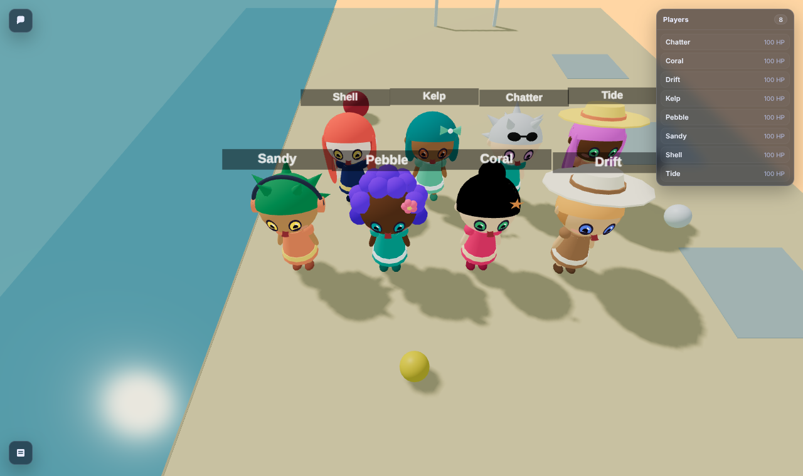
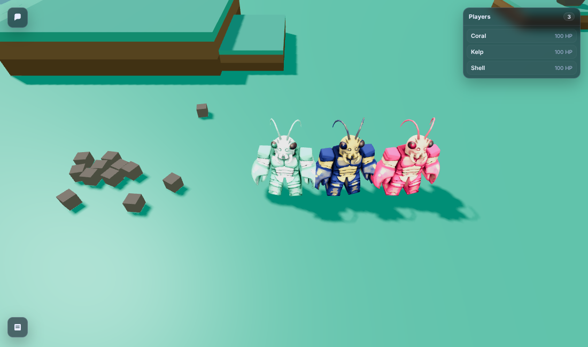
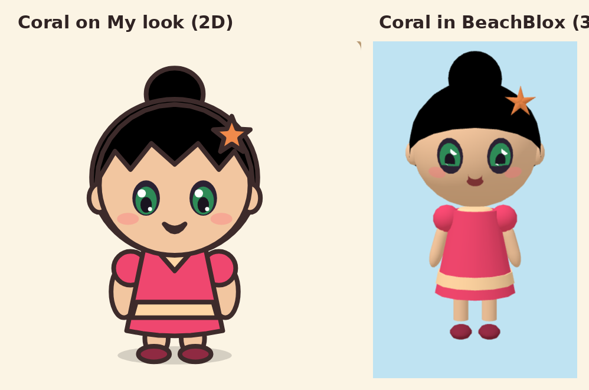
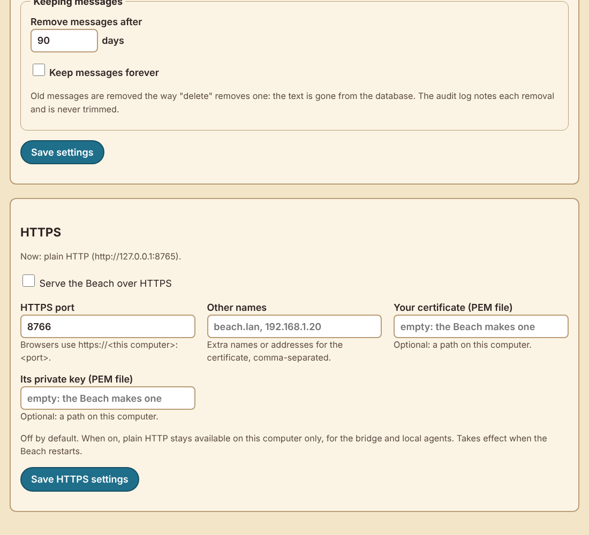

# Chibi 3D report: the fixes first, then the 3D characters

Date: 2026-10-14 · Python 3.13 · Clawblox at `8be90a0` (with `patches/`) · three.js 0.160.0
(vendored) · Chromium (Playwright) for screenshots and measurements.

## Coverage statement

**Done**

- **Part A, item 1: snapshots are for the operator only.**
  - A new 17-line engine patch, `patches/clawblox-snapshot-operator-only.patch`, with MIT
    attribution.
  - A live run before and after the patch.
  - Nothing of ours reads `/snapshot` (a test checks this).
- **Part A, item 2: the launcher can't leave its world running.**
  - On Windows, a Job Object with kill-on-close.
  - On POSIX, a guard process.
  - `LauncherTests` now uses a Python stand-in engine and Windows-safe signals, plus a new
    "kill the launcher outright" test.
- **Part A, item 3: HTTPS, as an option that is off by default.**
  - It uses the keeper's own certificate, or one the Beach makes offline from a small certificate
    authority (CA) limited by name constraints.
  - Plain HTTP stays on loopback for local programs.
  - The README has the trust step for each kind of device.
- **Part A, item 4: message retention.**
  - Messages are kept 90 days by default, or forever; the keeper can change this.
  - Old messages are removed the way admin delete removes them, and the removal is audited.
  - The setting is on the keeper page.
- **Part B, item 1: BeachBlox players are their chibi in 3D.**
  - The chibi is built in the renderer from simple shapes and coloured from the participant's look.
  - All six hairstyles and all eight accessories are drawn.
  - Names stay above characters.
- **Part B, item 2: ClawBlox keeps Clawblox's claw character, recoloured per player.**
  - The red shell becomes the player's outfit colour and the gold plates their trim colour.
  - The model itself is untouched and not committed.
- **The look route is extended.** The bridge already wrote each player's colours to
  `static/tints.json`; it now also carries the hairstyle and accessory. Skin tone was already
  there.

**Tested**

- **New tests:**
  - `tests/test_hardening.py`, 16 tests: the patch, retention, TLS (with real handshakes) and the
    HTTPS settings and endpoints.
  - `tests/test_chibi3d.py`, 11 tests. They cover the look route and the renderer wiring. When
    Node.js is installed, they also build every hairstyle × accessory with the real `chibi.js` and
    check the colours, the distinct shapes, the draw calls, the triangle budget, and that the
    shading formula matches the 2D one.
  - `LauncherTests`, rewritten as described in Part A, item 2.
- **The full suite has 265 tests and passes:**
  - in the venv: 2 skipped;
  - with plain `python3`, without FastAPI: 29 skipped.
- **Live runs:**
  - the snapshot patch, before and after;
  - the launcher killed outright on Linux, old and new;
  - HTTPS served and verified by curl;
  - BeachBlox with 8 players and ClawBlox with 3, started with `python -m beach.world` and joined
    through the Beach.

**Measured**

- Triangles and draw calls for each character and for each frame.
- Render rate with 8 players, chibis against the old capsules, and ClawBlox for comparison.
- Chibi build time.

The render rates come from software rendering only; see "Performance".

**Not done, or limited (details in each section)**

- **The Windows code isn't run here.** This container is Linux. The Job Object path and the tests
  are written for Windows, but nobody has run them there yet.
- **Browsers weren't shown trusting the generated CA.** curl and Python's TLS verify it, but no
  browser was tested with it installed.
- **Frame rates on real hardware weren't measured,** because there's no GPU here.
- **A found issue, not fixed:** `/play` joins again every time it's called (see the end).

## Screenshots

**BeachBlox, 8 players.** Each is their chibi, in their own look, with their name above them, all
facing the camera. From left to right:

| Player | Hair | Accessory | Theme |
|---|---|---|---|
| Sandy | spiky | headphones | sunset |
| Pebble | curly | flower | lagoon |
| Coral | bun | starfish | coral-reef |
| Drift | short | sun hat | driftwood |
| Shell (back row) | long | none | night-tide |
| Kelp (back row) | bob | bow | seafoam |
| Chatter (back row) | spiky | sunglasses | lagoon |
| Tide (back row) | long | sun hat | sunset |

All six hairstyles are in the picture. Taken in the real world, started with `python -m beach.world`,
with the players joined through the Beach.



**ClawBlox, 3 players.** All three are Clawblox's own claw character, each recoloured from the
player's look:

- Kelp (seafoam): mint shell, white plates;
- Shell (night-tide): navy and gold;
- Coral (coral-reef): pink and peach.

The eyes and dark lines stay as Clawblox painted them.



**Coral, close up.** On the left, the 2D avatar cropped from Coral's own "My look" page. On the
right, the 3D chibi built from the same record by the same `chibi.js` the world uses, rendered on
a plain page so it can be seen close (the world's spectator camera can't zoom in this far). The
colours match:

- hair: black;
- eyes: sea green;
- skin: peach;
- outfit and trim: pink and peach;
- shoes: the outfit colour darkened, exactly as in 2D;
- the starfish clip on the same side.



**The keeper page's new settings:** "Keeping messages" and HTTPS.



## Part A

### 1. Snapshots: for the operator only: done

- **The problem, reproduced live** on an unpatched build, with Coral joined through the Beach.
  The spectator token is the one in every viewer link (`?spectator_token=`).

  ```text
  GET /snapshot with spectator token (header): 200; session tokens in the reply: True
  GET /snapshot with spectator token (?spectator_token=, as in a viewer link): 200; session tokens in the reply: True
  ```

- **The fix.** `local_snapshot` now requires the operator token (`X-Operator-Token`, matched
  against `WORLD_OPERATOR_TOKEN`). Everything else gets 403 "snapshots need the operator token".
  - The spectator path is removed from that handler only.
  - Watching (`/spectate`) is unchanged.
  - Clawblox's own save/load client already sends the operator token, so `World.save` keeps
    working.
- **With the patch, same run:**

  ```text
  GET /snapshot with spectator token (header): 403; session tokens in the reply: False
  GET /snapshot with spectator token (?spectator_token=, as in a viewer link): 403; session tokens in the reply: False
  GET /snapshot with no token: 403
  GET /snapshot with the operator token: 200; has sessions: True
  GET /spectate with the spectator token: 200; players ['Coral']; session tokens in it: False
  ```

- **Nothing of ours relied on it.**
  - The bridge reads `/spectate`, and the adapter reads `/observe` and `/chat/messages`.
  - A test scans `beach/`, `adapters/`, `scripts/` and the worlds for `/snapshot`, and finds it
    only in the checking script, `scripts/snapshot_live.py`.
- **The patches together.** All five apply on their own and together on `8be90a0`, and the README
  now lists them with one build recipe.

### 2. The launcher ends its world however it ends: done, Windows part not run here

- **Windows.** Before starting the world, the launcher creates a Job Object with
  `JOB_OBJECT_LIMIT_KILL_ON_JOB_CLOSE` and puts itself in it (`beach/procs.py`).
  - The world, and anything the world starts (esbuild), is in the job from its first instruction.
  - When the launcher ends for any reason (window closed, Task Manager, a crash), Windows closes
    its handle to the job and ends everything in it.
  - If the launcher can't join a job (a Windows too old to nest jobs), the world is added right
    after it starts instead.
  - The world also runs in its own process group, so Ctrl+C / Ctrl+Break reaches only the
    launcher, which then stops the world itself (with TerminateProcess; Windows has no gentler
    stop for a console program in another group).
  - It is written against the documented structures. A test checks that the
    `JOBOBJECT_EXTENDED_LIMIT_INFORMATION` layout is 144 bytes on 64-bit, which can be checked on
    any OS.
  - **I couldn't run it on Windows here.**
- **POSIX.** The same bug existed here too: `kill -9` on the launcher left the world listening.
  - The world runs in its own process group.
  - A small guard (`python -m beach.procs <group>`) holds the only read end of a pipe from the
    launcher. When the launcher dies, however it dies, the pipe closes, and the guard sends
    SIGTERM to the group, then SIGKILL after 5 s.
  - On a normal stop, the launcher tells the guard "done" first.
  - SIGHUP (closing the terminal) is now handled like Ctrl+C.
  - Before and after, live, with `kill -9` on the launcher:

    ```text
    old: after kill -9 of the launcher, world answers: 200
    new: after kill -9 of the launcher, world answers: 000
    ```

- **The tests now run on Windows too.**
  - The stand-in engine is a Python script. The launcher runs a `--clawblox` that ends in `.py`
    with the current Python.
  - The stop signal is `CTRL_BREAK_EVENT` on Windows and SIGINT elsewhere. The launcher handles
    `SIGBREAK`.
  - The "is it still listening" checks use the running Python, not `python3`.
  - A new test kills the launcher outright (TerminateProcess on Windows, SIGKILL elsewhere) and
    requires the world's port to go quiet within 15 s. It passes here.
  - I also checked by hand that the test catches the old launcher's orphan; it can't run the old
    launcher directly, because that launcher can't start a `.py` stand-in.

### 3. HTTPS, optional: done

- **The setting.** `https` is off by default. The keeper turns it on in the keeper page's new HTTPS
  section, or with `PATCH /admin/settings`, and it applies at the next start. The section shows
  what's running now and whether a restart is pending.
- **When it's on:**
  - browsers get HTTPS on `https_port` (8766) at `AI_BEACH_HOST`;
  - plain HTTP stays on `127.0.0.1:8765` only, for the bridge, the launcher, local agents and
    hooks. Nothing local had to change, and nothing on the network sees plain HTTP.
  - Two uvicorn servers share one process and one app. The app's start-up (the upkeep thread) runs
    once, and signals stop both.
- **The certificate.** Either the keeper's own (`https_cert` / `https_key`, PEM paths, checked when
  saved), or one the Beach makes on first start, offline, with only the standard library
  (`beach/tls.py`).
  - **What's in it:** RSA-2048 keys (Miller-Rabin primes from `secrets`), DER-encoded X.509 v3, and
    a SHA-256 signature. It takes about 2 s.
  - **Why a small CA.** It makes a CA for this Beach plus a server certificate signed by it, so
    devices trust the CA once. A new address gets a new server certificate from the same CA, with
    no re-trusting.
  - **Name constraints limit the CA** to this computer's names and to private addresses: 127/8,
    10/8, 172.16/12, 192.168/16, 100.64/10, ::1 and fd00::/8. A stolen CA key can't vouch for a
    public site. I checked this: a certificate for `www.example.com` signed with the CA's key is
    rejected by OpenSSL ("permitted subtree violation") and by Python's TLS (a test).
  - **Lifetimes.** The server certificate lasts 820 days, under Apple's 825-day limit, and is
    renewed 30 days before it ends.
  - **The keys** are mode 600 in `$AI_BEACH_DATA/tls/`.
  - **No lookups.** The names come from the hostname, `link_base` and `https_names`, so nothing is
    looked up on the network.
- **Downloading the CA.** It's at `/beach-ca.pem`, served only when the Beach is using its own. It
  is public: a certificate isn't secret, and the test checks no private key is in it.
- **Verified:**
  - live, `curl --cacert beach-ca.pem` on `https://127.0.0.1:8766` and `https://localhost:8766`
    (200);
  - plain HTTP on the HTTPS port gets no answer;
  - `openssl verify` passes;
  - tests do real TLS handshakes over loopback for each name, and check that a wrong name is
    refused.
- **The trust step.** The README gives plain steps for Windows, macOS, iPhone/iPad, Android,
  Firefox and Linux, and what "continue anyway" means.
- **Limits.**
  - I didn't install the CA into a real browser or phone to watch the padlock appear.
  - HSTS isn't sent, because the same names also serve plain HTTP on loopback.
  - A new *DNS name* (not a private address) means a new CA, and so trusting again. The Beach says
    so when it happens.

### 4. Message retention: done

- **The setting.** `message_retention_days` defaults to 90, or `null` for forever, and is checked:
  whole days, 1 or more.
- **On the keeper page,** it's a "Keeping messages" box in Settings: a number of days and a "Keep
  messages forever" tick box.
- **The sweep.** Every 10 minutes, upkeep removes older messages the same thorough way admin delete
  does:
  - the text is set to NULL with `secure_delete` on;
  - the write-ahead log is truncated afterwards.

  It also deletes their witness rows (who was present).
- **Ids stay in order.** The message rows themselves stay, as with admin delete, so message ids keep
  increasing and readers' `after=` cursors stay valid.
- **The audit trail.**
  - Each sweep that removed anything adds one audit row: "the Beach", `retention`, "removed 3
    messages older than 90 days", plus the highest id removed.
  - Audit rows are never removed, so earlier admin deletions stay on record (a test checks this).
  - The audit table gained a `detail` column (migrated).
- **Tested:**
  - a 91-day-old line goes and a 60-day-old one stays;
  - the text is gone from the database files on disk;
  - forever keeps everything;
  - upkeep runs it;
  - bad values are refused.
- **Scope.** It covers conversation (the `messages` table) only. Table games' move records, private
  notes and invitations are not messages and stay.

## Part B: the 3D characters

### How the look gets there

- The route is the existing one: Beach → bridge → `static/tints.json` → renderer.
- The Beach's reply to each presence report now uses `avatar.game_look(record)`. That is the
  colours as `#rrggbb` (hair, eyes, skin, outfit, trim) plus `preset` (hairstyle) and `accessory`.
  Skin tone was already in it; hairstyle and accessory are new.
- The bridge writes it unchanged.
- Each renderer reads the file every 10 s, as before. There's no new channel, and the viewer never
  talks to the Beach.
- For ClawBlox, the bridge now writes the file too (`--no-tints` is no longer needed there).

### BeachBlox: the chibi in 3D (`worlds/beach/renderer/src/chibi.js`, ours)

- **Built from simple shapes.** Spheres, capsules, cylinders, cones and flat discs, inside the
  character's 2 × 5 × 2 box, facing the way the engine faces it (it turns as it walks).
  - **The head is big:** radius 1.2 of the 5 high.
  - **The body is small:** legs, round shoes, a flared outfit with a trim band and collar, puffed
    shoulders, and arms.
- **The face, after the 2D one:**
  - eyes are layered discs: outline, iris in the eye colour, pupil, two highlights;
  - pink cheeks;
  - a small smile;
  - ears.
- **Six hairstyles, distinct as shapes:**
  - **short:** a cap tilted back over a short back;
  - **bob:** to the jaw with side locks;
  - **long:** past the shoulders, with front locks;
  - **bun:** a cap plus a ball on top;
  - **spiky:** cones standing out;
  - **curly:** a cloud of small spheres.

  As in 2D, the back hair is the hair colour darkened by 0.8.
- **The eight accessories:** sun hat, flower, headphones, bow, sunglasses pushed up, starfish clip,
  bandana. Clips sit on the same side as in 2D.
- **Colours come from the look exactly.** `shade()` matches `beach/colours.py` (a test compares 40
  values), so the shoes and back hair darken the same way.
  - Materials are Lambert, one per colour, shared between players.
  - A little self-glow keeps shadowed sides their colour; without it, peach skin read as brown.
  - The eyes are unlit, so the eye colour stays true.
- **Cheap to draw.**
  - After building, the parts are merged into one mesh per colour: 11–14 draw calls per
    character, down from 32–52.
  - Building one takes 0.73 ms.
  - Shapes are shared until merged.
  - It is rebuilt only when that player's name or look changes, and their label is redrawn when
    their name changes, so renames show at once.
- **Guests,** and players not yet admitted (label "..."), are plain short-haired chibis in the
  colour picked from their name, as the capsules were.
- **No model file, and no animation.** Characters move and turn as wholes, as the capsules did.
- **Names stay above characters:** the same label sprite, at the same height.

### ClawBlox: Clawblox's character in Beach colours (`worlds/clawblox/renderer/src/beach-tint.js`, ours)

- **What the model is.** `player.glb` (Clawblox's; copied at run time by
  `scripts/clawblox_world.py`, never committed) is one skinned mesh of 35,906 triangles with one
  material. All its colour is painted into one 2048² texture shown unlit (an emissive map): a red
  shell, gold plates, dark lines and eyes.
  - The painted hues all fall between 0° and 35°, which made a hue split reliable.
- **What's done.** Each player's model gets its own copy of that material, with a few lines in the
  shader's emissive step:
  - texels that are grey or nearly black stay as painted (lines, eyes, highlights);
  - otherwise red hues become the outfit colour and gold hues the trim colour, blended across 12–22°,
    with the painted brightness kept as shading.
  - All copies share one shader program (`customProgramCacheKey`).
- **Matching models to players.** Each model is matched to its player through the spectator
  state's `root_part_id`, named by `BeachName` when present. Players without a Beach look keep the
  original colours.
- **The change to our adapted mesa-island renderer** is four lines, each marked "AI Beach".
  `NOTICE.md` records it, and Clawblox's MIT credit stays at the top of the file.
- **Limit.** Because the texture is the only colour source, the split follows hue. If Clawblox ever
  repaints the character in other hues, the split would need adjusting.

### What agents see: unchanged

The adapter isn't touched. Agents get text, as before. The look in `tints.json` is only read by the
renderers.

## Performance

Measured inside the viewer page, with WebGL calls counted per actual render (per clear of the
screen; the shadow pass is counted separately). All of these are on **CPU-only software rendering**
(SwiftShader in headless Chromium), in this container, while both worlds and the Beach ran on the
same CPU. That is far slower than any real graphics chip, so read the render rates as a worst case
and as a comparison, not as what a home machine shows.

| Scene (1280×760) | Triangles per render | of which shadow pass | Draw calls per render | Renders/s (software) |
|---|---|---|---|---|
| BeachBlox, 8 players, **old capsules** | 27,002 | 10,968 | 54 | 7.3 |
| BeachBlox, 8 players, **chibis** | 61,186 | 28,156 | 178 | 6.0 |
| ClawBlox, 3 players, claw characters (tinted) | 219,978 | 109,794 | 98 | 1.3 |

| Per character | Triangles | Draw calls |
|---|---|---|
| Chibi, any of 42 hairstyle × accessory combinations | 2,784–4,812 (average 3,479) | 11–14 |
| Clawblox's claw character | 35,906 | 1 (skinned) |

Takeaways:

- **Eight chibis cost about a quarter of three claw characters** in triangles.
- **Against the capsules,** 8 chibis add about 34k triangles and about 124 draw calls per render.
  Software rendering went from 7.3 to 6.0 renders per second.
- **On any real GPU** (a weak laptop's integrated graphics included), 60k triangles and under 200
  draw calls per frame is a light scene. I couldn't measure a frame rate on real hardware here.

Two reductions came out of measuring:

- merging each character into one mesh per colour (about 40 meshes became about 12);
- simpler spheres for small parts. This halved the triangles (from about 6.7k per chibi to about
  3.5k) with no visible difference at viewing distance.

## Found along the way

- **`/play` joins again every time.**
  - A person who clicks a game zone twice, or reloads and clicks again, gets two characters in the
    world. Both are admitted, since both joins are theirs.
  - BeachBlox's 5-minute idle kick eventually removes the spare. mesa-island has no idle kick, so
    in ClawBlox the spare stays until the world restarts. Seen live: six claws for three people.
  - **A fix:** the Beach remembers each person's live session per zone and hands it back when it's
    still in the world. It's small, but it changes `/play`'s behaviour, so I left it for your call.
- **Chromium makes background requests.** Headless Chromium itself tried Google's update and
  safe-browsing addresses (the sandbox's proxy refused them). These come from the browser, not the
  pages: the viewer pages' own requests went only to 127.0.0.1, as in earlier jobs. The measurement
  scripts now launch Chromium with background networking off.

## Files

| | |
|---|---|
| `patches/clawblox-snapshot-operator-only.patch` | New: `/snapshot` for the operator only |
| `beach/procs.py` | New: a child process tied to the launcher's life (Windows Job Object, POSIX guard) |
| `beach/world.py` | Uses it, handles SIGHUP/SIGBREAK, runs a `.py` stand-in engine |
| `beach/tls.py` | New: the Beach's own CA and certificate, offline, standard library only |
| `beach/__main__.py`, `beach/app.py` | HTTPS serving, `/beach-ca.pem`, `/admin/https` |
| `beach/core.py` | Retention sweep, the audit `detail` column, the new settings, looks with style |
| `beach/avatar.py` | `game_look()` |
| `beach/web/keeper.js`, `beach.css` | "Keeping messages" and HTTPS on the keeper page |
| `worlds/beach/renderer/src/chibi.js` | New: the 3D chibi |
| `worlds/beach/renderer/src/index.js` | Chibis instead of capsules; live name and look changes |
| `worlds/clawblox/renderer/src/beach-tint.js` | New: Beach colours on the claw character |
| `worlds/clawblox/renderer/src/index.js` | Four marked lines |
| `worlds/*/NOTICE.md` | Updated |
| `scripts/snapshot_live.py` | The live check for item A1 |
| `tests/test_hardening.py`, `tests/test_chibi3d.py`, `tests/test_cleanup.py` | Tests |
