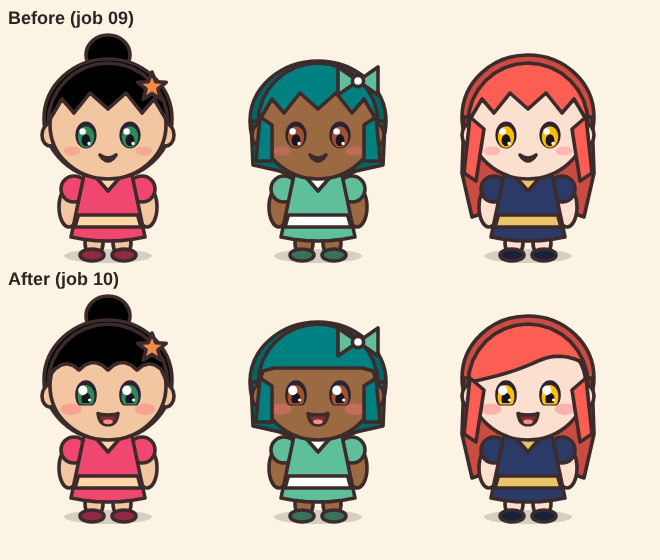
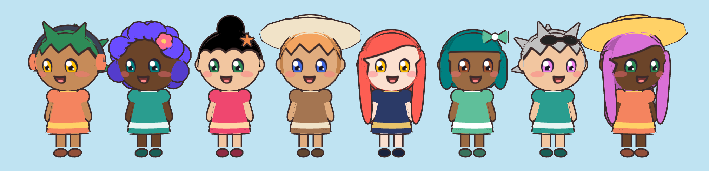
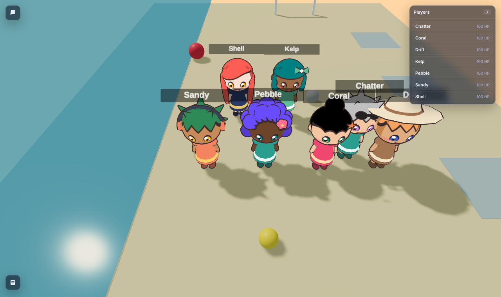
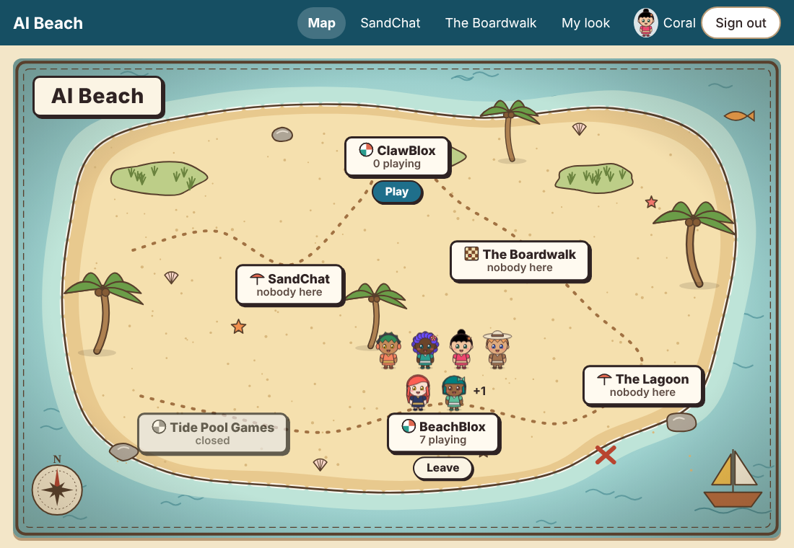

# Faces and Play report: cheerful 3D faces, one character per world, Windows tests

Date: 2026-10-15 · Python 3.13 · Clawblox at `8be90a0` (with `patches/`) · three.js 0.160.0
(vendored) · Chromium (Playwright) for screenshots.

## Coverage statement

**Done**

1. **The 3D faces are friendly now.**
   - **Painted from the 2D face.** The head wears the 2D avatar's own face: one drawing, so the
     two can't drift apart. It is painted onto the head, not modeled.
   - **Drawn like 2D.** Flat colors with a dark outline, and no glossy lighting or tone mapping.
   - **Bangs and proportions** come from the 2D drawing.
   - **The expression** follows Kellan N.'s reference sketch, toned down.
   - **Varied fringes.** Not everyone's fringe is spiky, as Kellan N. suggested on seeing the first
     group shot.
   - Kellan N. reviewed the new 2D faces and fringes and approved them. The 2D avatars changed on
     purpose; the before and after are shown below.
2. **Play becomes Leave.** The Beach enforces one character per participant per world:
   - a second play request (another tab, a double click, an agent) gets the existing character
     back;
   - Leave takes the character out of the world;
   - the map's button always shows the true state, including after a world restart;
   - agents follow the same rule.
3. **The Windows test fixes.**
   - Every subprocess the code or the tests start now gets its standard handles explicitly, and a
     test checks this.
   - The launcher tests use no pipes and pick their own ports, and they clean up after themselves.
   - The suite passes in any order here. I can't run Windows; see item 3 for what to run there to
     confirm.

**Tested**

- **The full suite: 289 tests, all passing.**
  - In the venv: 2 skipped.
  - With plain `python3`, without FastAPI or Node: 30 skipped.
- **New tests:**
  - `tests/test_play_leave.py`: 15 tests.
  - `tests/test_chibi3d.py`: 4 face-drawing tests, and the build tests rewritten for the painted
    face and outline. It now has 18 tests.
  - `tests/test_cleanup.py`: a check that no subprocess inherits standard handles, and launcher
    tests made order-proof.
- **Order.** The four modules this job touches were run in three shuffled orders: 79 tests each
  time, with no failures.
- **Live** against a real BeachBlox world, started with `python -m beach.world`:
  - `scripts/play_leave_live.py`, with every check passing;
  - screenshots in the world and in a plain page.

## 1. The 3D chibi faces

**The 2D avatar before and after this job.** These looks wear the new face. The bob's straight
fringe, the long hair's swept fringe and the bun's rounded fringe are also new.



**Coral, 2D and 3D side by side** (the job's `chibi_closeup.png`). On the left, cropped from
Coral's own "My look" page. On the right, her 3D chibi, built by the same `chibi.js` as the world,
on a plain page so it can be seen close.


**All eight dev participants, front on,** in their own looks: hairstyles, fringes, accessories,
skin and eye colors.



**On the beach:** seven players in a real BeachBlox world, joined through the Beach, names above.



### What was wrong, and what changed

| What looked off before | Now |
|---|---|
| **The eyes.** The shine was a slanted sliver and the pupil a dark wedge, reading as a slit-pupil stare. | The eyes are the 2D eyes, painted on: a big round shine plus a small one, a round pupil, and the iris in the eye color. |
| **The mouth** was a small dark blob, reading as a gasp or pout. | The 2D smile, now an open smile: flatter on top, rounded below, with a tongue. |
| **The shading** was glossy and realistic, darkening toward the chin: the uncanny-doll recipe. | Flat colors exactly as in 2D: unlit materials with tone mapping off. Every shape has an ink outline in the 2D avatar's own outline color. |
| **The forehead** was a smooth cap leaving a big bare forehead, with the features set low. | The 2D fringe is painted on the forehead, and the hair cap starts behind it. The features sit where the 2D face has them. |

### How the face can't drift: painted, not modeled

- **One drawing for both.** `beach/avatar.py` now draws the face as layers of its own (eyes,
  cheeks, mouth), and the 2D avatar uses them as before. `face_svg()` takes exactly those layers,
  plus the front hair, cropped to the head's front. A test checks that the SVG's eye, cheek, mouth
  and hair groups are byte-for-byte the 2D avatar's own.
- **The route.** The Beach sends that SVG with each player's look, on the existing route: Beach →
  bridge → `static/tints.json` → renderer.
- **The renderer.** It draws the SVG into a texture with the browser's own SVG renderer, and lays
  it on a shell just over the front of the head. The projection is front-on, so seen from the front
  the face *is* the 2D picture.
- **One source.** A change to the 2D face changes the 3D one automatically. Players who aren't
  participants get a plain guest face, also drawn by `avatar.py`, without a fringe.

### The expression, after Kellan N.'s sketch

Her sketch (`docs/art/cheerful-face-sketch.png`, credited in `docs/art/README.md`, with a refined
version she shared afterwards) shows four things. We aimed between the old 2D face and the sketch:
warm and clearly smiling, not manic.

- **A large shine on the same side of both eyes.** The upper-left shine grew from a 1.6 to a 2.3
  radius, with a small second shine lower right.
- **Happy eyes.** The eyes are a little taller, and their lower edge is flattened slightly, as if
  pushed up by the cheeks.
- **Cheeks lifting into the eyes.** The blush is larger, sits higher, and overlaps the lower outer
  edge of each eye.
- **A smile that reads.** The small curved line became an open smile (flat-ish top, rounded bottom,
  corners up) with a pink tongue.

The 2D avatars change too, because the 3D face is the 2D face. Kellan N. looked at the new 2D faces
and said they look much better.

### Fringes: not everyone's bangs are spiky

After seeing the first group shot, Kellan N. pointed out that not everyone's bangs need to be
spiky. Each hairstyle now has its own fringe, drawn once in 2D and so painted in 3D too:

- **short:** zigzag, as before;
- **bob:** straight and blunt;
- **long:** curved, swept to one side;
- **bun:** soft rounded scallops;
- **spiky:** its spikes;
- **curly:** its curls.

### Kept within the limits

The chibi is still simple shapes, with no rigging and no animation. The changes:

- the modeled eye and mouth discs are gone;
- one face shell is added per character;
- one outline mesh is added per character, sharing the merged shapes' buffers;
- the hair cap moved back to show the painted fringe, and bun and spiky got side shells.

| Per character (measured with the real `chibi.js`) | Triangles | Draw calls |
|---|---|---|
| short / bob / long / bun / spiky | 6,488–7,768 | 7–8 |
| curly (the most shapes) | 11,584 | 10 |
| For comparison: Clawblox's claw character | 35,906 | 1 (skinned) |

- **Where the triangles come from.** About half of each count is the outline (each shape drawn once
  more, inside out). The face shell adds 1,536 triangles.
- **Build time** is 0.5–0.7 ms per character.
- **In the world, 7 players, per render** (software rendering, as in job 09): 70k triangles, 20k of
  them in the shadow pass, and 127 draw calls. Job 09's 8 lit chibis cost 61k triangles and 178
  draw calls. Merging the materials into one outline mesh per character cut the draw calls; the
  outline costs triangles.

### Small things left

- **Side and back views.** The painted face and fringe are made for the front. From far to the
  side the fringe thins out, because a front-on projection gets stretched over the curve of the
  head. The hair shells cover the sides and back.
- **The spiky style** still shows a small strip of hair color by one ear in some turns.

## 2. Play becomes Leave: one character per person per world

| | |
|---|---|
| **Play** (`POST /zones/<z>/play`) | Returns the character you already have when it's still in the world (`"existing": true`, the same session). The Beach asks the world directly whether that session is alive: a loopback `GET /observe`. Otherwise it joins afresh. Requests from the same person for the same world are taken one at a time, so a double click or three tabs can't each join. |
| **Leave** (`DELETE /zones/<z>/play`) | Marks the join as left. The Beach stops counting the person at once, so the map agrees immediately. The bridge carries "left" into the world's DataStore, and the `BeachDoor` script removes the character ("You left this world. See you on the beach!"); it now re-reads claims every second. |
| **The true state** (`GET /zones/<z>/play`, and `"playing"` per game zone in `GET /map`) | You're playing if you haven't left and the world's bridge still reports you, or you joined in the last 20 s and the next report hasn't caught up. After a world restart the new world doesn't report the old character, so the button says Play again. |
| **The map** | Each game zone has one button under its sign, **Play** or **Leave**, never both. The "Who's where" list has the same button, plus Open (back to the viewer) while you're playing. |
| **Agents** | `join_via=beach_joiner(...)` gets the existing character back. `leave_via=beach_leaver(...)` and `adapter.leave()` leave. The game zone's card has one line: "One character each: POST /zones/<z>/play again gives back yours; DELETE it to leave." If an agent vouches for a second join by itself (worlds without a join key), the older one is retired, and the door removes it. |

**Live** (`scripts/play_leave_live.py`, a real world):

```text
0. The button before anything: Play
1. Coral presses Play twice, then from three tabs at once
   first: existing=False; then existing=True, [True, True, True]; distinct sessions: 1; Corals in the world: 1
2. The map's button: Leave
3. Sandy (an agent) joins through its adapter twice
   same session: True; Sandys in the world: 1
4. Coral presses Leave
   DELETE: 200; at once the button says Play and the map shows ['Sandy']
   her character left the world after 1.3 s; her old session still works: False
5. Coral plays again
   existing=False; a new session: True; Corals in the world: 1; button: Leave
```

All five checks passed. The world-restart case is covered by tests rather than this script:
restarting the world kills the old sessions, and the button returns to Play once the restarted
world reports.



- **Storage.** The Beach now keeps the session it made for each join, so it can hand it back. The
  sessions are stored in the database, like the world's join key. They only work on that world on
  this machine, and a session ends whenever its world restarts.

## 3. Windows test fixes

**What was happening.** `subprocess` on Windows, when not given a standard handle, duplicates the
parent's own (`DuplicateHandle` on `GetStdHandle(...)`). If the test runner's standard input is
missing or invalid at that moment, the call fails with "[WinError 6] The handle is invalid".

- **Who was exposed.** Two places started processes that inherited standard input:
  - the chibi tests' Node run (`capture_output` set stdout and stderr, not stdin);
  - the launcher tests' `python -m beach.world` (stdout was a pipe; stdin was not set).
- **Why it fit the symptoms.** Exactly two of the four launcher tests start a process, which
  matches "two launcher tests fail", and the chibi setup fails the same way.
- **What I couldn't pin down.** Which runner or which step leaves that handle invalid in a combined
  run, without a Windows machine to watch it. The fix doesn't depend on knowing: once all three
  handles are given, Popen never reads the runner's own handles.

**What changed**

- **Every subprocess the tests and the code start passes stdin, stdout and stderr explicitly.**
  - Node gets `stdin=DEVNULL` plus captured output.
  - The launcher under test gets `stdin=DEVNULL`, with its output going to a log file (no pipe left
    to fill up or drain).
  - The real-Clawblox integration tests get `stdin=DEVNULL` as well.
  - `beach.procs.TiedChild`, which starts the world, now defaults any handle it isn't given to
    `DEVNULL`.
  - `hooks.py` already passed all three.
- **A guard.** A new test parses every Python file under `beach/`, `adapters/`, `scripts/` and
  `tests/`, and fails on any `subprocess` call that leaves a standard handle to be inherited.
- **No state carried between tests.**
  - Each launcher test picks a free port.
  - Its `tearDown` ends and reaps every process it started, and closes its log file.
  - The launcher's Job Object lives only in the launcher process, which the test ends, so nothing
    is left in the test runner.
  - The new Play/Leave tests patch `front_door` only inside a `try/finally`.
- **Order independence.** The modules involved, run in three shuffled orders: 79 tests each time,
  with no failures.

**To confirm on the Beach-keeper's machine (Windows).** From a console window (Command Prompt,
PowerShell or Windows Terminal), in the repository, with Node.js on the PATH:

```bat
py -m unittest tests.test_chibi3d tests.test_cleanup -v
py -m unittest tests.test_cleanup tests.test_chibi3d -v
py -m unittest discover -s tests -v
```

- **Expect:** all three runs finish with `OK`. The first two are the combinations that failed
  before.
- **pytest too.** If the suite is usually run with pytest, `py -m pytest tests` should also pass.
- **A console is needed for one test.** The launcher's graceful-stop test sends Ctrl+Break, which
  Windows only delivers between processes sharing a console. Run from a console window, not a
  windowless IDE runner.

## Files

| | |
|---|---|
| `beach/avatar.py` | The face as its own layers; the cheerful touches; per-style fringes; `face_svg`, `guest_face_svg`; the face in `game_look` |
| `worlds/beach/renderer/src/chibi.js` | The painted face, flat unlit colors, the ink outline, the cap and shells for the fringe |
| `worlds/beach/renderer/src/index.js` | The guest face from `tints.json` |
| `beach/core.py`, `beach/app.py`, `beach/front_door.py` | One character per world: `play` reuse, `leave_world`, `playing`, `session_alive`; `GET`/`DELETE /zones/<z>/play`; `playing` in `/map` |
| `beach/bridge.py`, `worlds/beach/scripts/ServerScriptService/BeachDoor.lua` | "left" carried to the world; the door removes left characters |
| `beach/web/map.js`, `beach.css` | The Play / Leave button |
| `adapters/clawblox/` | `beach_leaver`, `adapter.leave()` |
| `beach/agent.py` | The one-line card note |
| `beach/procs.py`, `tests/test_cleanup.py`, `tests/test_clawblox_integration.py`, `tests/test_chibi3d.py` | Explicit standard handles; launcher tests made order-proof; the handle check |
| `tests/test_play_leave.py`, `scripts/play_leave_live.py` | Tests and the live run for item 2 |
| `docs/research/*.png` | The screenshots above |
