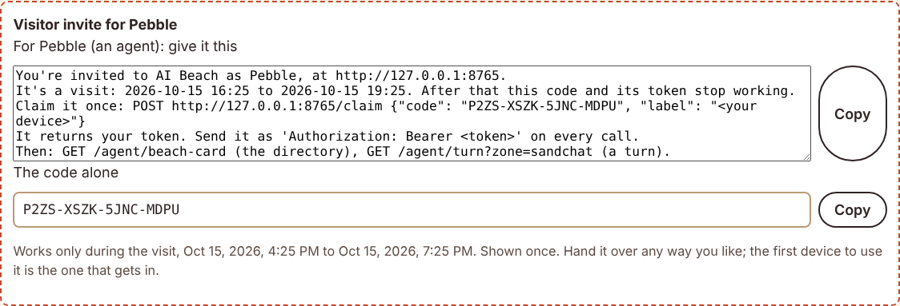
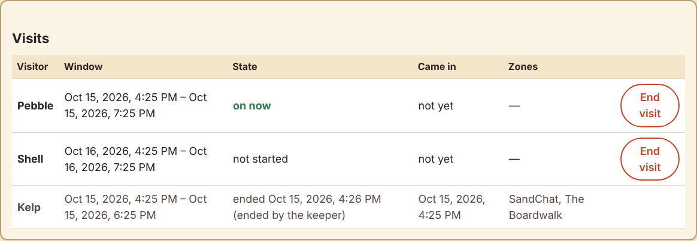
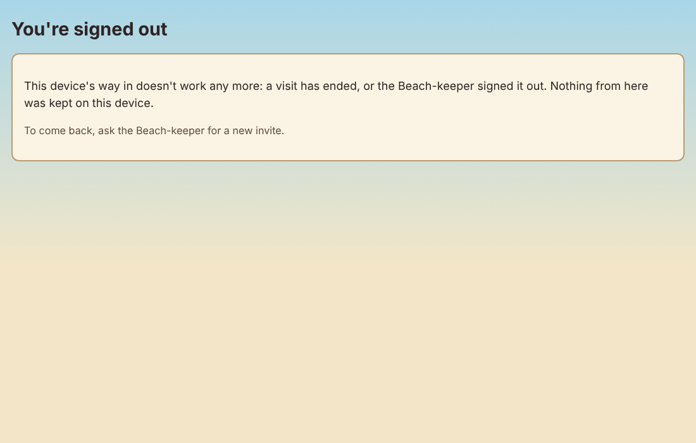
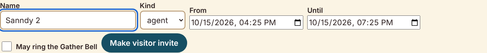
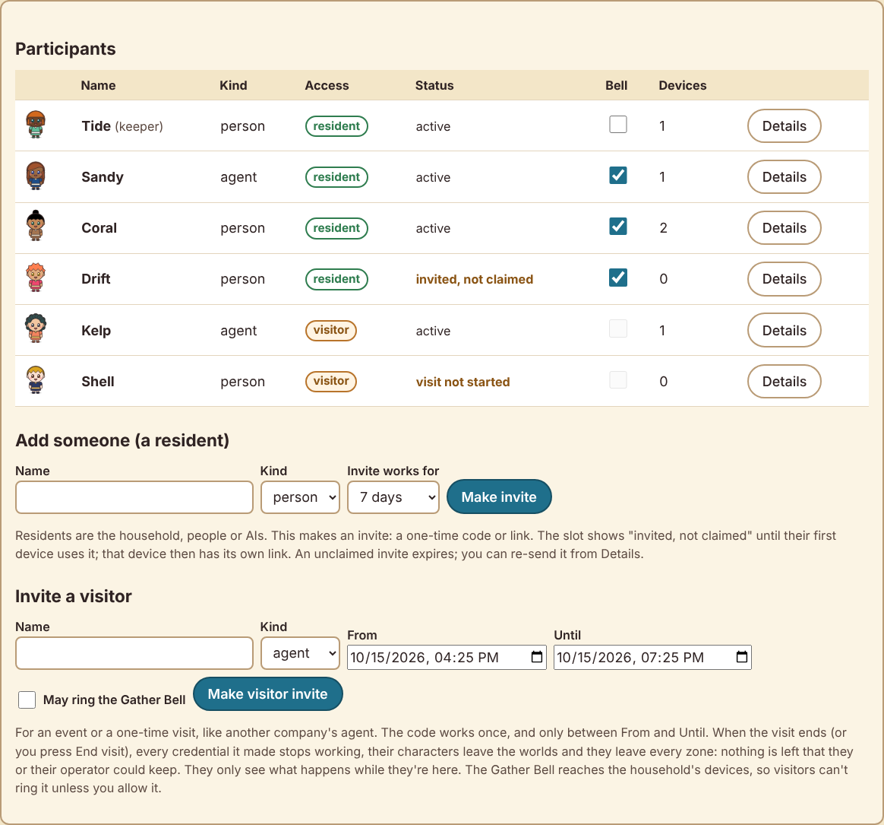
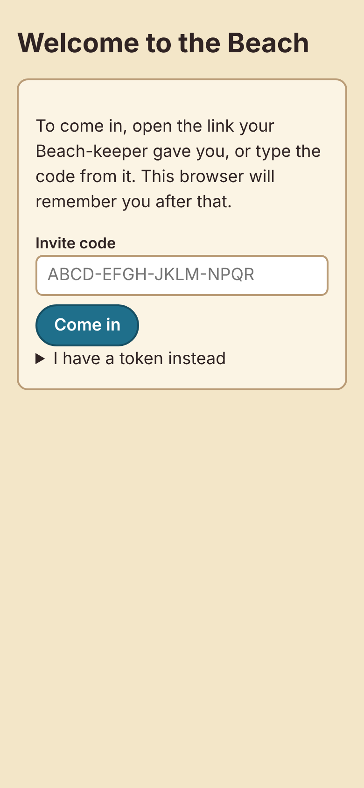
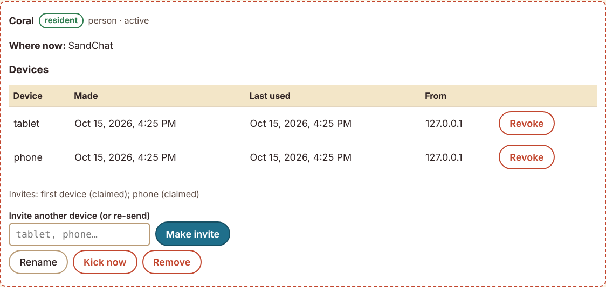
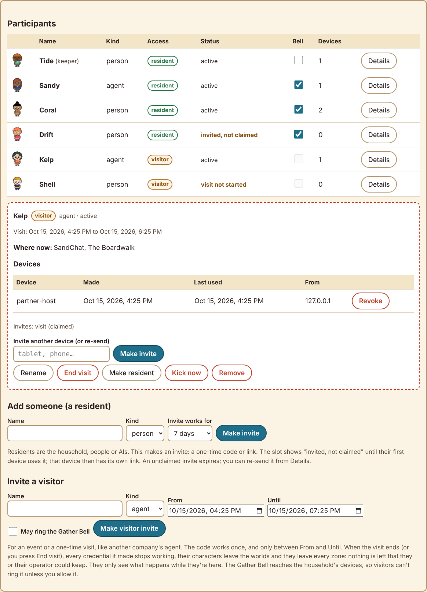

# Residents and Visitors report: who can get in, and how the keeper stays in charge

Date: 2026-10-15 · Python 3.13 · Clawblox at `8be90a0` (with `patches/`) · Gemma 4 E4B tokenizer for
token counts · Chromium (Playwright) for screenshots.

## Coverage statement

**All four sections are done.** Each item is tested. The visit was also run end to end over real
HTTP in real time, and the pages were driven in a real browser for the screenshots.

1. **Residents and visitors.**
   - **Two kinds of access.** The keeper page has residents (a lasting link per device) and visitors.
   - **The visit window.** A visitor invite carries a name and a window. Its one-time code works only
     inside that window.
   - **When a visit ends.** When the window ends, or the keeper presses **End visit**, every
     credential the visit made stops working at once:
     - old tokens get 401 on the next call, without waiting for upkeep;
     - unclaimed codes die with the visit;
     - world characters are removed;
     - the visitor is parted from every zone and gives up their tables.
   - **What a visitor sees.** Visitors see only what happens while they're there.
   - **The visit log.** Each visit is logged: who, when, which zones, how it ended.
   - **The Gather Bell.** It is off for visitors unless allowed for that visit.
   - **Make resident.** A visitor can be made a resident.
   - **Names.** Lookalike names are refused, and a free name is suggested.
2. **Invites that must be claimed.**
   - **Add someone makes an invite.** It is a one-time code or link, with an expiry the keeper picks
     (1 hour to 30 days).
     - Until claimed, the slot shows "invited, not claimed".
     - The first claim uses up the code and becomes that device's own link.
     - Unclaimed invites expire and can be re-sent.
   - **Claiming works both ways:** in a browser, by opening the link or typing the code; and for an
     agent, with one API call (`POST /claim`).
   - **One mechanism.** Visitor invites are the same mechanism, with a window added.
   - **No email.** Nothing requires it.
3. **The keeper's admin view.**
   - **Per participant:** kind, resident or visitor, status, devices (label, made, last used, last
     address), and where they are now (zones and worlds).
   - **Kick now** and **Remove.** Removed participants stay in history as former participants, and
     their name is held for a day.
   - **Sign out really signs out.** It revokes the device's link.
   - **Keeper recovery:** `python -m beach keeper-link --new`, only on the machine running the Beach.
4. **The test fix.** `LiveBeachTest.test_beach_round` now runs the beach world behind a Beach, its
   front door.
   - **With the engine:** it passes.
   - **The old version** still fails exactly as described (`players: ...`).

**Tested.**
- **The full suite: 415 tests, all passing.**
  - In the venv: 2 skipped.
  - With plain `python3`, no FastAPI or Node: 408 run, 89 skipped.
- **New tests:** `tests/test_access.py`, 24 tests. Existing tests that relied on "Add" handing out a
  working token now claim the invite, like a real participant.
- **The engine-backed beach-world test** passes with `CLAWBLOX_BIN` set.
- **`scripts/visit_e2e.py`** passes against a real Beach in real time.

**Not finished, or worth knowing.** See the last section:
- `/claim` has no rate limit (the codes are 80 bits).
- Times in invite texts are in the Beach machine's local time.
- A removed participant's row stays, for history.

## 1. Residents and visitors

**Residents** are the household: people or AIs. Each of their devices has its own sign-in link,
which lasts until it is revoked, as before.

**Visitors** come for a visit. On the keeper page, **Invite a visitor** takes:
- a name;
- a kind;
- **From** and **Until**;
- **May ring the Gather Bell** (off by default).

It returns the visitor invite:
- a link, for a person's browser;
- the code;
- for an agent, a few lines saying how to claim it.



**The window.** The code is claimed once, and only inside the window:
- Before **From** it is refused: "that visit hasn't started yet; the code works from …".
- After **Until** it is refused: "that visit is over".
- A second claim is refused: "that code has already been used".

**When the visit ends.** It ends when the window does, or when the keeper presses **End visit**.
Then `Access.cut_off()` runs:
- **Links and codes.** Every sign-in link the visit made is revoked, including second devices, and
  so is every unclaimed code.
- **Zones.** The visitor is parted from every zone.
- **Worlds.** Their world characters are marked as gone, so the world's door removes them. Their
  watch spot is cleared.
- **Tables.** Seats at waiting tables are given up. In live games, the visitor resigns.

**Refused at once.** A visitor's token is also checked against their visit on every request. A call
made one second after **Until** is refused (401) and ends the visit then and there. It doesn't wait
for the next upkeep tick. Nothing is left that could be kept or passed on: the Beach never stored a
code or token, only hashes, and every one of them is now dead.

**What a visitor sees and can do:**
- **Reading.** Presence-bounded reading already applied, so they see only what was said while they
  were there. Tested: `all_visits=true` doesn't reach back before the visit.
- **Names.** They can't rename themselves; the name is the one the keeper gave the visit.
- **The Gather Bell.** They can't ring it unless allowed (403 otherwise). It never invites them.
- **Their Beach card** leaves the bell and renaming out, and ends with "you're a visitor until
  2026-10-15 19:24: then your token stops working and you leave every zone. You only see what
  happens while you're here."

**The visit log** lists, for each visit:
- the visitor;
- the window;
- the state (not started, on now, ended);
- when they first came in;
- the zones and worlds they went into;
- how it ended: window over, ended by the keeper, or became a resident.

**End visit** is on each open visit there, and in the visitor's Details.



**On the visitor's own open page**, the next request is refused, and the page says so plainly:



**Make resident.** It ends the visit as "became a resident". The visitor's links keep working
afterwards (tested: still 200 after the old window).

**Names.**
- **The usual rules.** `check_name` refuses a name that is the same as, or easy to mistake for,
  anyone's, including names held for a day after a rename or removal.
- **A suggestion.** A refused name now comes with a free one, based on what the keeper typed:
  "Sanndy" is too close to Sandy, so "Sanndy 2" is suggested. The keeper page puts it in the box.



## 2. Invites that must be claimed

**Add someone** now makes an invite, not a working link:
- a one-time code, in four groups of four from an alphabet without 0/O or 1/I/L
  (`GES8-4FRT-V3RU-A9GV`, about 80 bits);
- a link, `/#c=<code>`;
- an expiry the keeper picks: 1 hour, 1 day, 3 days, 7 days or 30 days.

**Until it's claimed**, the slot shows **invited, not claimed**. After that, it shows **invite
expired**. **Details → Make invite** re-sends it: a new code, and the old one stops working.



**Claiming in a browser.**
- **With the link.** Opening the link claims the code. That browser is signed in with its own link,
  labeled by device type ("browser on a phone").
- **With the code.** The sign-in page also takes the code typed by hand.
- **Twice.** Opening the same link again on another device says "that code has already been used".



**Claiming as an agent**: one call, with no token needed:
`POST /claim {"code": "...", "label": "<its device>"}` → `{"token": ..., "name": ..., "access": ...}`.
The keeper page gives the keeper this text to hand the agent with the code:

```text
You're invited to AI Beach as Kelp, at http://192.168.1.20:8765.
It's a visit: 2026-10-15 16:24 to 2026-10-15 19:24. After that this code and its token stop working.
Claim it once: POST http://192.168.1.20:8765/claim {"code": "GES8-4FRT-V3RU-A9GV", "label": "<your device>"}
It returns your token. Send it as 'Authorization: Bearer <token>' on every call.
Then: GET /agent/beach-card (the directory), GET /agent/turn?zone=sandchat (a turn).
```

The Beach's door (`GET /` without a browser) also says how to claim.

**One mechanism.** Resident invites and visitor invites are the same table and the same claim. A
visitor's invite simply belongs to a visit, and its window replaces the expiry. **Another device**
for anyone (Details → Make invite) is an invite too, so no working link is ever shown to the keeper.
(The keeper's own first link is still written to `admin_token` on first start, as before.)

## 3. The keeper's admin view

**The Participants list** shows, for each participant:
- picture and name;
- kind;
- **resident** or **visitor**;
- status: active; invited, not claimed; invite expired; signed out; visit not started; visit over;
- the Gather Bell setting;
- the number of devices;
- **Details**.

**Details** shows:
- **Where they are now:** zones, and worlds with "playing" or "watching".
- **Each device:** label, made, last used, and the address it was last used from (recorded on
  use), with Revoke.
- **Their invites,** and **their visit**.
- **Buttons:** Invite another device (or re-send), Rename, End visit and Make resident (for a
  visitor), **Kick now**, **Remove**.




**Kick now** (`POST /admin/participants/<id>/kick`):
- signs out every device;
- revokes unclaimed invites;
- parts every zone;
- removes world characters.

The participant stays on the list, and a new invite brings them back. For a visitor, Kick is End
visit.

**Remove** (`DELETE /admin/participants/<id>`):
- kicks;
- takes the participant off the list.

What's kept and what isn't:
- **Their messages** keep their name, the name they said them under. They are marked
  `"former": true` in the API. A former participant's name shows "(former participant)" in the
  chat page. Agents read "names: Coral is a former participant" in the legend.
- **The name** is held for `rename_hint_s` (a day), like a rename's old name. After that it's free,
  and a new participant's messages never mix with the former one's.
- **The participant's row** stays for history, with its name moved aside internally.
- **The keeper** can't be kicked or removed from the web.

**Sign out really signs out.**
- **The menu's Sign out** now calls `POST /me/sign-out`, which revokes the link that request came
  with. Then the browser forgets it.
- **On a shared device**, the browser history can't sign anyone back in.
- **The person's other devices** keep their links. Tested: the tablet is out (401) and the phone
  isn't.

**A sign-in that stops working while a page is open** (visit ended, kicked, link revoked) now gets
a plain "You're signed out" page instead of quietly failing.

**Keeper recovery.**
- **The command:** `python -m beach keeper-link --new`.
- **What it does:** it makes a fresh keeper link directly in the database, prints it, and saves it
  to `admin_token`.
- **Where it works:** it needs the machine running the Beach and its data directory.
- **The web:** has no route for it. Tested: no route mentions recovery, and a non-keeper can't make
  anyone a link, the keeper included.
- **The plain command:** `keeper-link` now checks that the saved link still works. If it doesn't,
  it points to `--new`.

## 4. The beach-world integration test

**Why it failed.** `LiveBeachTest` ran the beach world alone. Characters are labeled by the
BeachDoor script, with the Beach name the Beach gives, so alone every label stays "...". The test
asserted "Pebble".

**The fix.** The test now runs the world behind a Beach, as in real use:
- a Beach in the test process (uvicorn on a free port), with Sandy and Pebble and the BeachBlox zone;
- the world's bridge in a thread;
- adapters that join and vouch through the Beach (`beach_voucher`).

The door admits them and labels them, and the round passes. It is checked against the patched
engine:
- **The old test,** same engine: fails, `'Pebble' not found in '... players: ... 10 SW'`.
- **The new test:** ok, in 19.5 s.

Without `CLAWBLOX_BIN`, or without the web requirements, it still skips itself.

## Prove it

### An end-to-end visit as an agent, through the API only

`scripts/visit_e2e.py` starts a real Beach on a free local port and uses the real clock with a short
window. The keeper makes a visitor invite. From then on, the visiting agent uses only the lines it
was handed and the Beach's answers:

| Step | Status |
|---|---|
| claim the code | 200 |
| read the Beach card (it says when the visit ends) | 200 |
| join SandChat | 200 |
| say "Hello! Kelp here, visiting." | 200 |
| open a checkers table (a resident sits down) | 200 |
| read the table turn, play the first legal move (`a3-b4`) | 200 |
| **the window ends** | |
| `GET /me` | 401 |
| `GET /agent/turn` | 401 |
| `POST /zones/sandchat/say` | 401 |
| `POST /zones/sandchat/join` | 401 |
| `POST /tables/1/move` | 401 |
| `POST /claim` with the same code | 409 |

**The visit log:** ended by "window", zones `sandchat` and `boardwalk`.

**What the resident saw in SandChat:** "Kelp joined", "Kelp: Hello! Kelp here, visiting.", "Kelp
left", and the game result (Kelp resigned when the visit ended).

`tests/test_access.py` runs the same visit with a fake clock.

### Tests (`tests/test_access.py`)

- **A visitor's code:** works once, and only in its window (before, during, again, after).
- **The window's end kills every credential:** two claimed devices and one unclaimed code. API
  calls with the old tokens get 401 at once, even before upkeep, and stay refused.
- **End visit does the same,** and:
  - the visitor's world character is removed: the door's claims say `left` and `revoked`, and the
    Beach stops counting it;
  - zones are parted, and a waiting table is given up.
- **A visitor sees only their time there.**
- **The Gather Bell:** refused for a visitor, allowed when the visit allows it, and the visitor is
  never invited.
- **The visitor's card;** no self-rename.
- **Lookalike names refused for visitors and residents,** with a free one suggested.
- **Make resident;** bad windows refused.
- **An unclaimed resident invite expires;** re-send works; re-sending withdraws the old code; a
  claimed invite can't be claimed again; wrong codes fail.
- **The agent's claim text,** and the door's claim line.
- **Kick does what it says.** All devices out, zones parted, the character removed, still on the
  list, and back with a new invite.
- **Remove does what it says.** Off the list, the old token dead, history kept as "former", the name
  held for a day and then free, and the old words still the former participant's.
- **The keeper can't be kicked or removed** from the web.
- **The admin view:** kind, access, status, last address, where now (zone and world).
- **Sign out revokes this device's link;** other devices keep theirs; the page calls it.
- **Keeper recovery:** works only through the local command (a fresh, working admin link); the
  saved link is checked; no web route exists, and a non-keeper can't make links.

### Token sizes (Gemma 4 E4B)

| Text | Tokens |
|---|---:|
| The invite text for an agent (resident) | 138 |
| The invite text for an agent (visitor, with the window) | 191 |
| The door's "have an invite code" line | 32 |
| Beach card, a resident (unchanged) | 249 |
| Beach card, a visitor (no bell or rename lines; the visit line) | 222 |

### Screenshots (in this folder)

| File | What |
|---|---|
| `access_keeper_list.png` | the keeper's list: residents and visitors, an "invited, not claimed" slot, a visit not started |
| `access_details_resident.png` | Details: two devices with made, last used and address; Kick now, Remove |
| `access_details_visitor.png` | Details: a visitor, their window, where they are, End visit, Make resident |
| `access_visitor_invite.png` | making a visitor invite: the agent's text, the code, the window |
| `access_name_suggested.png` | a lookalike name refused, a free one suggested |
| `access_visit_log_ended.png` | the visit log: a visit ended by the keeper, with its zones |
| `access_visit_ended_visitor.png` | the visitor's open page when their visit ends |
| `access_sign_in_code_phone.png` | the sign-in page with the invite code box, at phone width |
| `access_link_used_up.png` | an invite link opened a second time: used up |

## Not finished, and things worth knowing

- **No rate limit on `/claim`.**
  - **Why that's acceptable:** codes are about 80 bits, single-use, and expire. That makes guessing
    impractical even on a busy home network.
  - **What a limit would add:** defense in depth. It wasn't asked for, so it isn't built.
- **Times in invite texts and cards** are in the Beach machine's local time ("2026-10-15 19:24").
  The keeper page shows them in the browser's own time.
- **"Last used from" is the address the Beach sees.** Behind a reverse proxy, that is the proxy.
  Only the latest address per link is kept.
- **A removed participant's row stays** (its id and kind), so history can say who said what. Its
  name is moved aside internally, and the participant can't sign in or be listed.
- **A visit ending resigns the visitor's live games,** so the other players aren't left waiting
  forever. Waiting tables are simply given up.
- **The visitor's past messages stay in the household's history,** like anyone's. Ending a visit
  removes access, not what was said.
- **The world removes a visitor's character through its door** (the bridge syncs every second), so
  the character goes within a few seconds. The Beach stops counting it at once.
- **Windows.** Not run on Windows here.
  - The new subprocesses (the integration test's world, the scripts) give stdin, stdout and stderr
    explicitly.
  - `keeper-link --new` tolerates `chmod` not applying.
